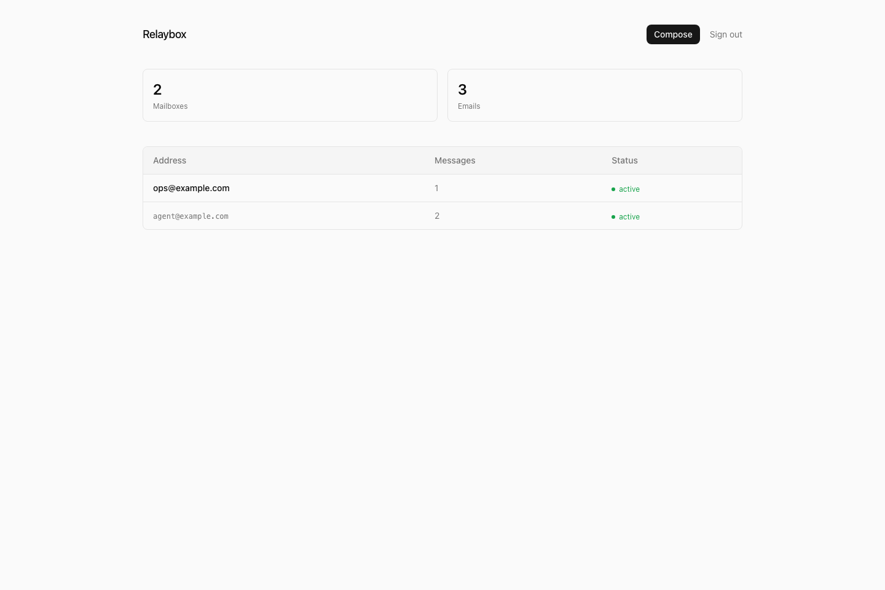

# Relaybox

Relaybox is an open inbox workspace for AI agents.



This repository is the OSS core:

- single-tenant admin auth
- inbox list and mailbox views
- message detail, labels, reply, forward, compose
- provider seams for inbound mailboxes, message storage, and outbound sending
- safe demo mode so the app runs without private infrastructure

This repository is not the managed SaaS:

- no multi-tenancy
- no billing
- no hosted domain onboarding
- no abuse controls or operational control plane

## Status

`v0.1` is positioned as a public alpha foundation, not a finished product.

The repo defaults to `MAIL_PROVIDER=demo` so you can evaluate the UX without AWS credentials.

## Quickstart

1. Install dependencies:

```bash
npm install
```

2. Copy the example environment:

```bash
cp .env.example .env.local
```

3. Set a unique admin password of at least 12 characters and generate a
   session secret of at least 32 characters. For example:

       openssl rand -base64 32

   Put those values in the local environment file. Keep the secure-cookie
   option disabled for local HTTP development and enable it behind production
   HTTPS.

4. Start the app:

```bash
npm run dev
```

5. Sign in with the configured admin password.

## Docker

Run Relaybox in demo mode with Docker Compose:

```bash
cp .env.example .env
# Set APP_ADMIN_PASSWORD and APP_SESSION_SECRET in .env first.
docker compose up --build
```

The demo app will be available at `http://127.0.0.1:3000`.

The Compose file mounts a named volume for `.data` so labels persist across container restarts.

## Demo Mode

Demo mode is the default:

- no AWS credentials required
- fixture-backed mailboxes and messages
- compose returns a synthetic message id
- labels are stored under `APP_DATA_DIR` (defaults to `.data`)

This makes the repository safe to evaluate in public and useful in CI.

## AWS Mode

Set `MAIL_PROVIDER=aws` and provide the AWS values from [`.env.example`](.env.example).

Expected storage shape:

- mailbox table with `address`, `type`, `status`, `message_count`
- message table with `message_id` as primary key
- message table index keyed by `mailbox_address`
- optional raw email body in S3 referenced by `s3_key`

Relaybox also supports an alternate DynamoDB layout used by earlier deployments:

- inbox table keyed by `inbox_id`
- message table keyed by `inbox_id` + `message_id`
- `by_inbox_received_at` for mailbox queries
- `by_message_id` for direct message lookup

The app no longer scans S3 for mailbox and message listing. Public deployments should keep reads indexed.

SES and Lambda can own ingestion while Relaybox reads indexed
mailboxes/messages and optionally sends through configured SES identities.
See [`ops/aws/README.md`](ops/aws/README.md) for the generic ingest and
backfill workflow.

## Security Notes

- Relaybox is a single-admin application. Put production deployments behind
  HTTPS and a trusted reverse proxy.
- Use a unique admin password and a random session secret; the app refuses weak
  or missing auth configuration.
- Enable secure cookies in production.
- Do not expose AWS credentials to the browser or commit real mailbox data.
- Message bodies render as plain text. Raw HTML is not injected into the page.
- This alpha does not include distributed login rate limiting; add it at the
  reverse proxy if the login page is internet-facing.

## Architecture

Runtime pieces:

- `AuthProvider`: single-admin signed session auth
- `InboundProvider`: mailbox catalog
- `MessageStore`: indexed summaries, message detail, labels
- `OutboundProvider`: sender identities and send behavior

Current implementations:

- demo providers under `src/lib/providers/demo`
- AWS-backed providers under `src/lib/providers/aws`

## Scripts

```bash
npm run dev
npm run lint
npm run test
npm run test:e2e
npm run build
npm run check
npm run check:release
```

## Release Boundary

Open source core:

- inbox workspace
- provider seams
- demo mode
- AWS-backed adapter path

Managed SaaS:

- organizations and roles
- hosted provisioning
- billing and quotas
- abuse prevention
- observability and operations

## Roadmap

Near-term:

- attachment downloads
- safe HTML rendering
- Postgres-backed store option
- documented REST API surface

Not first:

- multi-tenancy
- enterprise auth
- IMAP
- complex workflow automation

## License

MIT. See [`LICENSE`](LICENSE).

## Project Docs

- [Contributing](CONTRIBUTING.md)
- [Security](SECURITY.md)
- [Release rubric](OPEN_SOURCE_READINESS.md)
